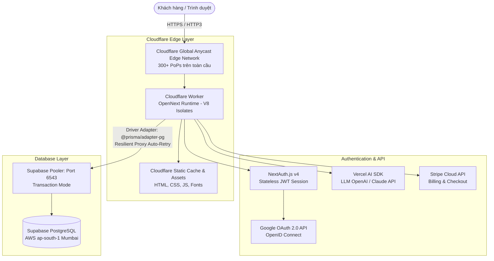
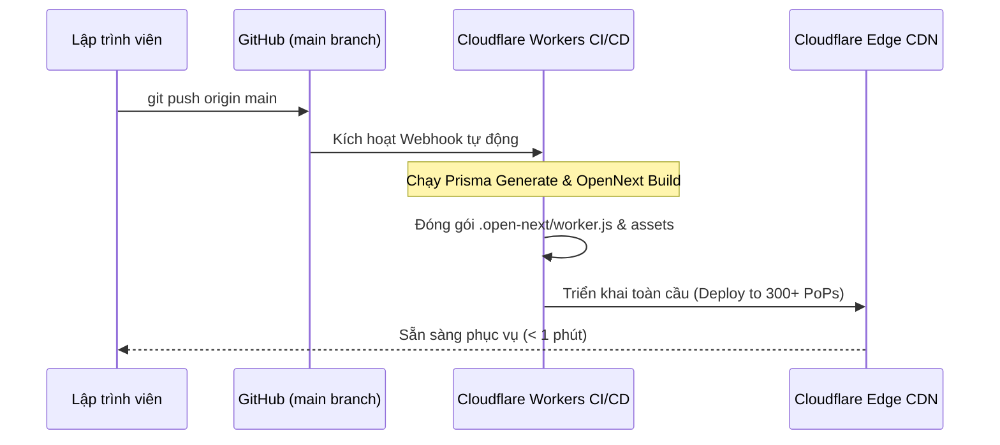
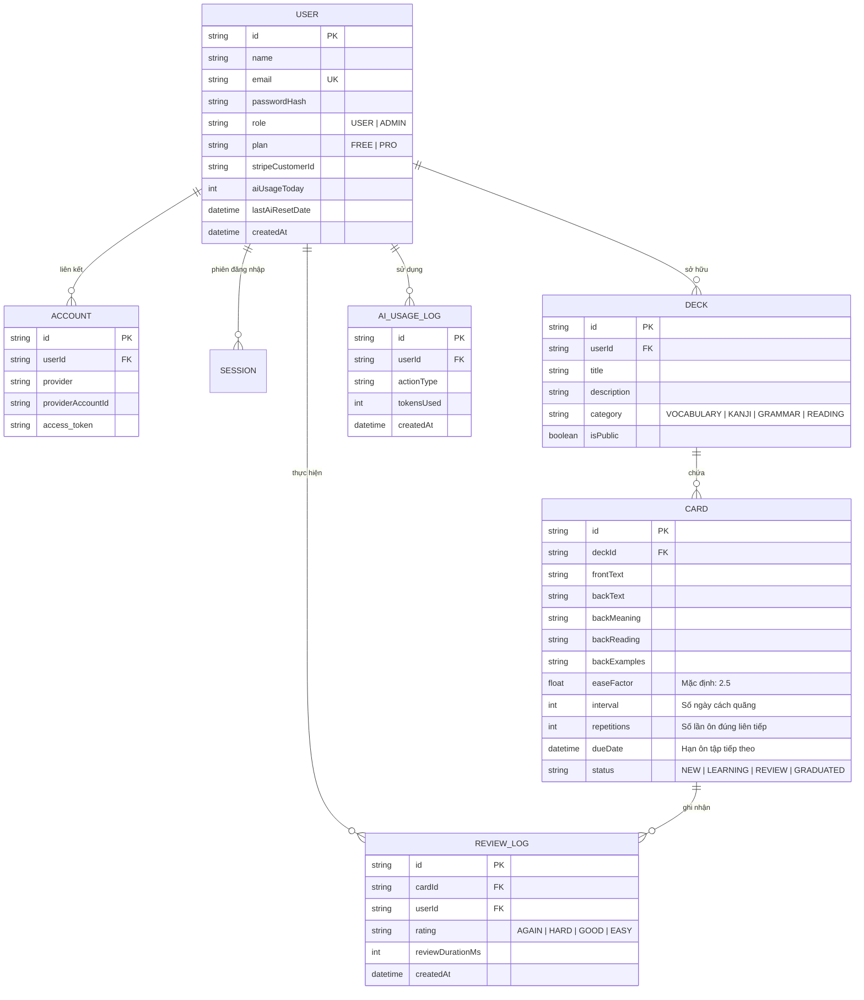

# TÀI LIỆU YÊU CẦU SẢN PHẨM & KIẾN TRÚC ĐÁM MÂY (PRD)
## N3 Master AI — Nền Tảng Chinh Phục JLPT N3 Cùng Trí Tuệ Nhân Tạo & SRS Anki

---

### Mục Lục
1. [Giới Thiệu Tổng Quan & Tầm Nhìn Dự Án](#1-giới-thiệu-tổng-quan--tầm-nhìn-dự-án)
2. [Đối Tượng Người Dùng & Bài Toán Cần Giải Quyết](#2-đối-tượng-người-dùng--bài-toán-cần-giải-quyết)
3. [Kiến Trúc Điện Toán Đám Mây (Cloud Architecture)](#3-kiến-trúc-điện-toán-đám-mây-cloud-architecture)
   - [3.1 Mô hình Serverless Edge Computing (Cloudflare Workers + OpenNext)](#31-mô-hình-serverless-edge-computing-cloudflare-workers--opennext)
   - [3.2 Cơ sở dữ liệu đám mây (Supabase PostgreSQL & Connection Pooler)](#32-cơ-sở-dữ-liệu-đám-mây-supabase-postgresql--connection-pooler)
   - [3.3 Hệ thống xác thực danh tính phân tán (NextAuth Edge JWT)](#33-hệ-thống-xác-thực-danh-tính-phân-tán-nextauth-edge-jwt)
   - [3.4 Tích hợp AI Serverless (Vercel AI SDK & LLMs)](#34-tích-hợp-ai-serverless-vercel-ai-sdk--llms)
   - [3.5 Thanh toán đám mây & Đăng ký gói cước (Stripe Cloud)](#35-thanh-toán-đám-mây--đăng-ký-gói-cước-stripe-cloud)
   - [3.6 Quy trình CI/CD & Tự động hóa triển khai](#36-quy-trình-cicd--tự-động-hóa-triển-khai)
4. [Bản Đồ Chức Năng Chi Tiết (Feature Breakdown)](#4-bản-đồ-chức-năng-chi-tiết-feature-breakdown)
   - [4.1 Bảng điều khiển học tập (Dashboard)](#41-bảng-điều-khiển-học-tập-dashboard)
   - [4.2 Hệ thống Flashcard & Thuật toán lặp lại ngắt quãng SRS SM-2](#42-hệ-thống-flashcard--thuật-toán-lặp-lại-ngắt-quãng-srs-sm-2)
   - [4.3 Phòng luyện Đọc hiểu chuyên sâu (Dokkai Room)](#43-phòng-luyện-đọc-hiểu-chuyên-sâu-dokkai-room)
   - [4.4 AI Studio (Trợ lý gia sư tiếng Nhật 24/7)](#44-ai-studio-trợ-lý-gia-sư-tiếng-nhật-247)
   - [4.5 Phòng thi thử chuẩn cấu trúc đề JLPT N3 (Mock Test)](#45-phòng-thi-thử-chuẩn-cấu-trúc-đề-jlpt-n3-mock-test)
   - [4.6 Minigames học tiếng Nhật (Games)](#46-minigames-học-tiếng-nhật-games)
   - [4.7 Thống kê & Phân tích lộ trình học (Analytics & Stats)](#47-thống-kê--phân-tích-lộ-trình-học-analytics--stats)
5. [Thiết Kế Cơ Sở Dữ Liệu (Database Schema)](#5-thiết-kế-cơ-sở-dữ-liệu-database-schema)
6. [Bảo Mật, Hiệu Năng & Khả Năng Mở Rộng](#6-bảo-mật-hiệu-năng--khả-năng-mở-rộng)
7. [Hướng Dẫn Dành Cho Lập Trình Viên Mới (Developer Onboarding)](#7-hướng-dẫn-dành-cho-lập-trình-viên-mới-developer-onboarding)

---

### 1. Giới Thiệu Tổng Quan & Tầm Nhìn Dự Án

* **Tên dự án:** N3 Master AI
* **Khẩu hiệu:** Chinh phục JLPT N3 cùng Trí tuệ Nhân tạo & SRS Anki
* **Production URL:** `https://n3-master-ai.binhn3832.workers.dev`
* **Mục tiêu:** Xây dựng một nền tảng học tập tiếng Nhật cấp độ JLPT N3 toàn diện, kết hợp phương pháp ghi nhớ khoa học lặp lại ngắt quãng (Spaced Repetition System - SRS) với năng lực phân tích ngôn ngữ tức thời của các mô hình AI tiên tiến, vận hành hoàn toàn trên hạ tầng **Serverless Cloud Computing** hiện đại với chi phí tối ưu và tốc độ tải trang cực nhanh.

---

### 2. Đối Tượng Người Dùng & Bài Toán Cần Giải Quyết

#### 2.1 Đối tượng người dùng
* Học viên tiếng Nhật đang chuyển tiếp từ N4 lên N3 (cấp độ có lượng từ vựng và kanji tăng gấp 3 lần).
* Người bận rộn cần tối ưu hóa thời gian học tập bằng phương pháp khoa học (15-20 phút/ngày).
* Người học gặp khó khăn với phần Đọc hiểu (Dokkai) và ngữ pháp phức tạp cần có trợ lý AI phân tích và dịch câu từng thành phần.

#### 2.2 Các bài toán được giải quyết
1. **Học trước quên sau:** Ứng dụng thuật toán **SM-2 (SuperMemo-2 / Anki)** tự động tính toán khoảng cách ngày ôn tập theo phản xạ nhớ của học viên (Again, Hard, Good, Easy).
2. **Đọc hiểu không hiểu ngữ cảnh:** AI Dokkai phân tích ngữ pháp, phân tách thành phần câu, hiển thị Furigana và bản dịch song ngữ chuẩn xác.
3. **Thiếu phản xạ thi cử:** Hệ thống Mock Test mô phỏng áp lực thời gian thật và cấu trúc đề chuẩn của kỳ thi JLPT N3.

---

### 3. Kiến Trúc Điện Toán Đám Mây (Cloud Architecture)

Hệ thống được thiết kế theo tư duy **Cloud-Native, 100% Serverless**, không sử dụng máy chủ truyền thống (No VPS, No Container EC2), tận dụng tối đa hạ tầng biên (Edge Computing).



---

#### 3.1 Mô hình Serverless Edge Computing (Cloudflare Workers + OpenNext)
* **Công nghệ cốt lõi:** Next.js 14 (App Router) được biên dịch sang worker script thông qua `@opennextjs/cloudflare`.
* **Cơ chế hoạt động:**
  - Ứng dụng không chạy trên Node.js server truyền thống (như Express hay PM2) mà chạy trực tiếp trên **V8 Isolates** của Cloudflare Workers.
  - Phân tán tại hơn **300 thành phố trên toàn cầu**, phản hồi request từ Edge server gần người dùng nhất (tại Việt Nam phản hồi từ trạm Hà Nội / TP.HCM), giảm ping xuống dưới **30ms**.
  - **Scale-to-Zero:** Khi không có người truy cập, tài nguyên tự động trả về 0, không tốn bất kỳ chi phí duy trì máy chủ nhàn rỗi. Khi có lượt truy cập, thời gian khởi động (cold start) chỉ tính bằng mili-giây (< 50ms).

---

#### 3.2 Cơ sở dữ liệu đám mây (Supabase PostgreSQL & Connection Pooler)
* **Vị trí cụm Database:** AWS khu vực Mumbai (`aws-0-ap-south-1.pooler.supabase.com`).
* **Supavisor Connection Pooler (Cổng 6543):**
  - Trong môi trường Serverless Edge, hàng trăm Worker instance có thể khởi chạy đồng thời. Nếu mở kết nối trực tiếp vào cổng 5432, số lượng socket TCP sẽ bị cạn kiệt (connection exhaustion).
  - Hệ thống sử dụng kết nối qua **Supabase Transaction Pooler (Cổng 6543)** kết hợp cờ `?pgbouncer=true`.
* **Resilient Prisma Auto-Retry Proxy (`lib/prisma.ts`):**
  - Khắc phục triệt để hiện tượng *Dead Socket Trap* khi V8 Isolate của Cloudflare đóng băng (freeze) và rã đông (thaw).
  - Tự động nhận diện lỗi `Connection terminated unexpectedly`, hủy kết nối cũ và tự động kết nối lại tối đa 3 lần với cơ chế exponential backoff, đảm bảo truy vấn không bao giờ bị đứt quãng.

---

#### 3.3 Hệ thống xác thực danh tính phân tán (NextAuth Edge JWT)
* **Phiên làm việc phi trạng thái (Stateless JWT):**
  - Thay vì lưu session trong bảng Session của Database (gây chậm và tiêu tốn kết nối), phiên làm việc được ký số và mã hóa trực tiếp trong cookie bảo mật (`__Secure-next-auth.session-token`).
  - Hỗ trợ đầy đủ cờ bảo mật cao: `HttpOnly`, `SameSite=Lax`, `Secure`.
* **Google OAuth 2.0 (OpenID Connect):**
  - Triển khai custom `token.request` và `userinfo.request` bằng chuẩn Web `fetch()` của Cloudflare Workers, vượt qua giới hạn chưa hỗ trợ `https.request` của runtime `unenv`.
  - Tự động cấp gói **PRO** và liên kết tài khoản an toàn (`allowDangerousEmailAccountLinking: true`).
* **Cơ chế Safe Adapter (`createSafePrismaAdapter`):**
  - Bảo vệ tiến trình đăng nhập: Ngay cả khi Database Supabase có độ trễ khởi động, người dùng vẫn đăng nhập thành công vào `/dashboard` mà không gặp lỗi `OAuthCallback`.
* **Credentials Provider:**
  - Đăng nhập bằng Email/Mật khẩu với thuật toán băm bảo mật.
  - Tích hợp sẵn tài khoản Demo độc lập (`demo@n3master.ai`) với cơ chế dự phòng tức thì.

---

#### 3.4 Tích hợp AI Serverless (Vercel AI SDK & LLMs)
* Sử dụng bộ thư viện `ai` và `@ai-sdk/openai` chạy streaming trực tiếp từ Edge về trình duyệt.
* **Các tác vụ AI:**
  1. Phân tích cấu trúc ngữ pháp và câu tiếng Nhật N3.
  2. Tự động sinh câu ví dụ song ngữ Nhật - Việt phù hợp với ngữ cảnh thực tế.
  3. Sửa lỗi diễn đạt trong bài viết của học viên kèm giải thích chi tiết.
  4. Trợ lý hội thoại nhập vai luyện phản xạ giao tiếp tiếng Nhật.
* **Quản lý hạn mức (Rate Limiting & Token Quota):** Bảng `AIUsageLog` theo dõi lượng token tiêu thụ mỗi ngày, tự động giới hạn người dùng FREE (5 lượt/ngày) và mở khóa không giới hạn cho người dùng PRO.

---

#### 3.5 Thanh toán đám mây & Đăng ký gói cước (Stripe Cloud)
* **Stripe Checkout:** Tạo phiên thanh toán nâng cấp tài khoản PRO an toàn qua cổng quốc tế.
* **Stripe Webhooks (`/api/stripe/webhook`):** Lắng nghe sự kiện `checkout.session.completed` và `customer.subscription.deleted` để tự động nâng cấp hoặc gia hạn gói tài khoản trong cơ sở dữ liệu.

---

#### 3.6 Quy trình CI/CD & Tự động hóa triển khai


---

### 4. Bản Đồ Chức Năng Chi Tiết (Feature Breakdown)

| Phân Hệ | Đường Dẫn (Route) | Mô Tả Chức Năng Chính | Công Nghệ Sử Dụng |
| :--- | :--- | :--- | :--- |
| **Trang chủ & Giới thiệu** | `/` | Giới thiệu tính năng, bảng giá, đánh giá của học viên, CTA đăng ký | Next.js Server Components, Tailwind CSS, Framer Motion |
| **Xác thực** | `/login`, `/register` | Đăng nhập Google 1-click, Email/Password, tài khoản Demo điền sẵn, tự động chuyển hướng `/dashboard` | NextAuth.js, Web Crypto, Lucide Icons |
| **Bảng điều khiển** | `/dashboard` | Tổng quan tiến độ học tập, streak liên tục, thẻ cần ôn hôm nay, đề xuất bài học tiếp theo | Client Components, SWR / Server Fetch, Local Storage |
| **Quản lý Bộ thẻ** | `/decks`, `/decks/[id]` | Danh sách bộ từ vựng, Kanji, Ngữ pháp; tạo bộ thẻ mới, gắn tag, quản lý danh sách thẻ flashcard | Prisma ORM, Dynamic Routes, Modal Form |
| **Ôn tập SRS** | `/review`, `/review/[deckId]` | Lật thẻ flashcard 2 mặt, phát âm Audio, đánh giá 4 mức (Again, Hard, Good, Easy) theo thuật toán SM-2 | SM-2 Algorithm, Canvas Confetti, IndexedDB offline cache |
| **Trắc nghiệm** | `/quiz/[deckId]` | Làm bài kiểm tra nhanh nhiều lựa chọn theo bộ thẻ, tính điểm và thời gian phản xạ | React State, Sound FX, Recharts |
| **Phòng Đọc hiểu** | `/dokkai` | Đọc báo/bài văn N3, nhấn vào từ để tra nghĩa, hiển thị Furigana, dịch từng câu, AI phân tích bài đọc | Text Parser, Tooltip Popover, OpenAI SDK |
| **AI Studio** | `/ai` | Chatbot gia sư tiếng Nhật, sửa bài viết ngữ pháp, tạo Flashcard tự động từ câu nhập vào | Vercel AI SDK, Streaming Response |
| **Thi thử N3** | `/mock-test` | Đề thi chuẩn format JLPT N3 gồm Từ vựng, Ngữ pháp, Đọc hiểu, Nghe hiểu; có đồng hồ đếm ngược và chấm điểm | Timer Hook, Audio Player, Score Calculator |
| **Trò chơi Mini** | `/games` | Minigame lật thẻ Kanji, nối từ vựng tăng cường phản xạ ghi nhớ vui nhộn | Framer Motion Animations, Sound Effects |
| **Thống kê** | `/stats` | Biểu đồ trực quan hóa số thẻ nhớ được, tỷ lệ duy trì kiến thức, lịch sử ôn tập theo tuần/tháng | Recharts, Date-fns, Aggregation Queries |
| **Cài đặt & Gói cước** | `/settings` | Quản lý thông tin cá nhân, chuyển đổi giao diện Sáng/Tối (Dark Mode), nâng cấp tài khoản PRO qua Stripe | Next-Themes, Stripe Elements |

---

#### 4.1 Bảng Điều Khiển Học Tập Thông Minh (Dashboard — `/dashboard`)
* **Mục tiêu & Giá trị:** Màn hình trung tâm giúp học viên định hình nhiệm vụ trong ngày, đo lường sự tiến bộ và duy trì tính kỷ luật liên tục.
* **Các thành phần cốt lõi:**
  1. **Đồng hồ đếm ngược JLPT:** Tự động tính toán số ngày còn lại đến kỳ thi JLPT N3 gần nhất (Chủ nhật đầu tiên của Tháng 7 hoặc Tháng 12 hàng năm).
  2. **Thanh chỉ số Gamification:** Hiển thị thời gian thực Cấp bậc (Level), Điểm kinh nghiệm (EXP), Số xu tích lũy (Coins), và Chuỗi ngày học liên tục (Streak 🔥). Tự động đồng bộ bằng Custom Event `gamification_update`.
  3. **Linh vật đồng hành (Mascot Companion):** Thú cưng tương tác động với biểu cảm thay đổi theo tiến độ và câu khích lệ tiếng Nhật mỗi ngày.
  4. **Gieo quẻ may mắn Omikuji (Daily Fortune):** Mô phỏng nét văn hóa truyền thống Nhật Bản, mỗi ngày học viên gieo một quẻ may mắn (Đại Cát, Trung Cát...) và nhận thưởng Xu ngẫu nhiên.
  5. **Bản đồ 12 Unit học tập (Curriculum Navigator):** Phân loại bộ thẻ thông minh theo 5 nhóm từ loại: Danh từ (NOUN), Động từ (VERB), Tính từ / Katakana (ADJ_KATA), Phó từ / Liên từ (ADV_CONJ), và Ngữ pháp (GRAMMAR). Tích hợp tìm kiếm nhanh theo tiêu đề và nội dung.
  6. **Lịch nhiệt hoạt động (Heatmap Calendar):** Trực quan hóa mức độ siêng năng 365 ngày tương tự phong cách GitHub Contribution Graph.
* **Luồng dữ liệu:** Next.js Server Component tìm nạp dữ liệu Decks và thẻ đến hạn (`dueDate <= NOW()`) qua Prisma Client với cơ chế fallback tĩnh đảm bảo Dashboard luôn tải tức thì.

---

#### 4.2 Hệ Thống Flashcard & Thuật Toán Lặp Lại Ngắt Quãng SRS SM-2 (`/review`, `/decks`)
* **Mục tiêu & Giá trị:** Giải quyết tận gốc vấn đề "học trước quên sau" bằng thuật toán Spaced Repetition System chuẩn khoa học (SuperMemo-2 / Anki), chỉ nhắc ôn từ vựng vào đúng thời điểm não bộ sắp quên.
* **Thuật toán cốt lõi (`lib/srs.ts`):**
  - Mỗi thẻ sở hữu 3 thông số động: Hệ số dễ nhớ $EF$ (mặc định $2.5$), Khoảng cách lặp lại $I$ (ngày), và Số lần nhớ liên tiếp $R$.
  - Khi học viên đánh giá độ khó:
    - **Again (Quên):** $R = 0$, $I = 1$ ngày, $EF = \max(1.3, EF - 0.2)$. Thẻ chuyển về trạng thái `LEARNING` để ôn lại ngay trong chu kỳ ngắn.
    - **Hard (Nhớ khó khăn):** $EF = \max(1.3, EF - 0.15)$, $I = \max(1, \text{round}(I \times 1.2))$. Thẻ ở trạng thái `REVIEW`.
    - **Good (Nhớ chuẩn):** $R = R + 1$. Nếu $R = 1 \Rightarrow I = 1$; nếu $R = 2 \Rightarrow I = 6$; nếu $R \ge 3 \Rightarrow I = \text{round}(I \times EF)$. Thẻ đạt trạng thái `GRADUATED`.
    - **Easy (Nhớ rất rõ):** $EF = \min(3.5, EF + 0.15)$, $R = R + 1$. Nếu $R = 1 \Rightarrow I = 4$; nếu $R = 2 \Rightarrow I = 10$; nếu $R \ge 3 \Rightarrow I = \text{round}(I \times EF \times 1.3)$.
  - Nhãn dự đoán thời gian ôn tiếp theo hiển thị trực tiếp trên nút bấm: `<10m`, `1d`, `6d`, `15d`.
* **Trải nghiệm lật thẻ 3D:**
  - **Mặt trước (Front):** Hiển thị Kanji / Từ vựng lớn, nút phát âm Audio giọng chuẩn bản xứ qua Web Speech API.
  - **Mặt sau (Back):** Phân tích chi tiết: Cách đọc Hiragana/Katakana, Âm Hán Việt, Ý nghĩa tiếng Việt, Câu ví dụ song ngữ Nhật - Việt, Phân tích từng chữ Kanji cấu thành (Kanji Breakdown).
  - Tích hợp hiệu ứng pháo hoa cát (`canvas-confetti`) và cộng thưởng EXP/Coins khi hoàn thành chu kỳ học.

---

#### 4.3 Phòng Luyện Đọc Hiểu Chuyên Sâu (Dokkai Room — `/dokkai`)
* **Mục tiêu & Giá trị:** Đọc hiểu là phần thi khiến học viên JLPT N3 dễ trượt nhất do áp lực từ vựng dài và ngữ pháp phức tạp. Phân hệ Dokkai áp dụng **Phương pháp Giàn giáo (Scaffolding Method)** giúp học viên từ sợ đọc đến làm chủ bài đọc.
* **Các tính năng nổi bật:**
  1. **Bộ đọc thông minh (Smart Reader):**
     - **Bật / Tắt Furigana linh hoạt:** Học viên có thể tắt Furigana để thử thách phản xạ Kanji, hoặc bật Furigana khi cần hỗ trợ.
     - **Bóc tách cấu trúc câu (Sentence Breakdown):** AI phân tích ngữ pháp từng câu trong bài, chỉ rõ Chủ ngữ, Vị ngữ, Bổ ngữ và các liên từ logic nối câu.
     - **Tra cứu từ tức thì (Interactive Word Tooltip):** Nhấp chuột hoặc chạm vào bất kỳ từ vựng nào trong bài để xem nghĩa tiếng Việt, Hán Việt, từ loại và cách phát âm ngay trên Popover mà không cần thoát khỏi bài đọc.
     - **Bản dịch song ngữ Nhật - Việt:** Ẩn/hiện bản dịch tiếng Việt từng câu hoặc toàn bài đối chiếu tư duy dịch thuật.
  2. **Bộ tạo bài đọc bằng AI (AI Dokkai Generator):** Cho phép học viên tự nhập chủ đề yêu thích (anime, du lịch, trà đạo, công nghệ...), AI tự động biên soạn bài đọc đúng cấu trúc câu và từ vựng chuẩn N3 kèm theo bộ câu hỏi trắc nghiệm kiểm tra độ hiểu.
  3. **Chiến lược đọc hiểu (Dokkai Strategy Guide):** Tích hợp cẩm nang các kỹ thuật đọc lướt tìm ý chính (Skimming), đọc quét tìm dữ liệu cụ thể (Scanning), và bẫy loại trừ đáp án nhiễu thường gặp trong đề thi N3.
  4. **Câu hỏi trắc nghiệm & Giải thích:** Mỗi bài đọc đi kèm câu hỏi chuẩn đề thi JLPT N3 kèm phân tích chi tiết vì sao đáp án đúng và vì sao các lựa chọn khác sai.

---

#### 4.4 AI Studio — Trợ Lý Gia Sư Tiếng Nhật 24/7 (`/ai`)
* **Mục tiêu & Giá trị:** Trải nghiệm học tập 1-kèm-1 với Trí tuệ Nhân tạo thế hệ mới (LLMs) chạy Serverless Streaming tốc độ cao, giải đáp mọi thắc mắc ngữ cảnh thực tế.
* **5 phân hệ AI chuyên sâu:**
  1. **AI Card Generator (Tạo thẻ tự động):** Nhập một từ vựng, ngữ pháp hoặc ý niệm -> AI tự trích xuất Kanji, Furigana, Hán Việt, Nghĩa tiếng Việt, Câu ví dụ và tạo ngay Flashcard lưu vào bộ thẻ.
  2. **AI Grammar & Vocab Explainer (Giải thích chuyên sâu):** Phân tích sắc thái ngôn ngữ, cách dùng trong thực tế và so sánh các mẫu ngữ pháp dễ gây nhầm lẫn (ví dụ: `～わけがない` vs `～はずがない`).
  3. **AI Quiz Generator (Tự sinh đề thi nhanh):** Sinh tức thời các câu hỏi trắc nghiệm N3 theo chủ đề mong muốn kiểm tra.
  4. **AI Sentence Correction (Sửa bài viết & Luyện đặt câu):** Học viên nhập câu tiếng Nhật tự viết -> AI phát hiện lỗi sai trợ từ, chia thể động từ, gợi ý câu viết chuẩn tự nhiên của người bản xứ và giải thích cặn kẽ ngữ pháp.
  5. **AI Sensei Chat (Trò chuyện nhập vai 24/7):** Trợ lý ảo đóng vai người Nhật trò chuyện theo tình huống đời sống (đặt phòng khách sạn, phỏng vấn xin việc, đi siêu thị...), tự động sửa lỗi diễn đạt sau mỗi tin nhắn.
* **Kiến trúc Serverless AI:** Vercel AI SDK với kỹ thuật **Edge Streaming Response** (Time to First Token < 0.5s), tích hợp bảng `AIUsageLog` kiểm soát hạn mức sử dụng giữa tài khoản Free và Pro.

---

#### 4.5 Phòng Thi Thử Chuẩn JLPT N3 (Mock Test — `/mock-test`)
* **Mục tiêu & Giá trị:** Giúp học viên làm quen với áp lực thời gian, cấu trúc đề và đánh giá năng lực thực tế trước kỳ thi thật.
* **Tính năng phòng thi thực tế:**
  1. **Đúng chuẩn format đề JLPT N3:** Thời lượng 105 phút với đầy đủ 3 phần thi: Kiến thức ngôn ngữ (Từ vựng/Kanji), Ngữ pháp & Đọc hiểu, Nghe hiểu (audio tích hợp).
  2. **Phiếu làm bài thông minh (Answer Sheet):** Bảng hiển thị danh sách toàn bộ câu hỏi (1..N), thể hiện câu đã làm / chưa làm và chuyển nhanh đến câu bất kỳ.
  3. **Gắn cờ câu hỏi (Flag for Review):** Cho phép đánh dấu các câu nghi vấn để kiểm tra lại trước khi nộp bài.
  4. **Chế độ tập trung (Focus Mode):** Khóa toàn màn hình, ẩn các thành phần gây xao nhãng.
  5. **Đồng hồ đếm ngược:** Cảnh báo khi còn dưới 5 phút và tự động thu bài khi đồng hồ về 00:00.
  6. **Thuật toán chấm điểm chuẩn JLPT:**
     - Tổng thang điểm: $180$ điểm. Điểm sàn đậu JLPT N3: $\ge 95 / 180$.
     - **Cơ chế điểm liệt chuẩn quốc tế:** Mỗi phần thi phải đạt tối thiểu $\ge 19 / 60$ điểm. Nếu tổng điểm $\ge 95$ nhưng có 1 phần thi dưới 19 điểm, hệ thống vẫn đánh giá là **TRƯỢT (FAIL)** do dính điểm liệt.
  7. **Tải lên đề thi tùy chỉnh (Custom Exam Uploader):** Cho phép nạp đề thi từ file JSON để học viên tự thi thử theo đề thi riêng của trung tâm.

---

#### 4.6 Đấu Trường Trò Chơi Học Tập & Gamification (`/games`)
* **Mục tiêu & Giá trị:** Biến quá trình học tập ngôn ngữ thành trải nghiệm giải trí tương tác cao (Learn-to-Play), nâng cao tỷ lệ giữ chân người học mỗi ngày.
* **8 Chế độ Game phong phú:**
  1. **Speed Match (Ghép thẻ siêu tốc):** Nối thẻ Kanji / Từ vựng và Nghĩa tương ứng trên lưới đa ô trong thời gian giới hạn.
  2. **Samurai Slash (Chém Kanji phong cách Ninja):** Chém đúng các từ vựng bay trên màn hình theo nghĩa yêu cầu.
  3. **Boss Battle (Đấu Boss theo lượt):** Nhập vai chiến binh tiêu diệt quái vật bằng cách trả lời đúng câu hỏi tiếng Nhật.
  4. **Sentence Scramble (Ghép câu ngữ pháp):** Sắp xếp các mảnh từ vựng bị đảo lộn thành câu hoàn chỉnh đúng trật tự N3.
  5. **Shadowing Studio:** Luyện nói nhại theo giọng đọc bản xứ qua sóng âm trực quan.
  6. **PvP Arena (Đấu trường 1vs1):** Ghép cặp so tài trắc nghiệm thời gian thực giữa hai người học.
  7. **Kanji Canvas (Tập viết chữ Hán):** Bảng vẽ cảm ứng tương tác nhận diện nét bút và thứ tự nét viết chuẩn.
  8. **Story Mode (Vượt ải Visual Novel):** Phiêu lưu khám phá văn hóa Nhật Bản qua từng chương cốt truyện.
* **Hệ sinh thái Gamification:**
  - **Hệ thống Cấp bậc (Level) & EXP:** Tính toán bằng công thức lũy tiến $Level = \lfloor \sqrt{EXP / 100} \rfloor + 1$.
  - **Cửa hàng thú cưng (Pet Shop):** Sử dụng Xu (Coins) kiếm được qua các bài học để mua sắm vật phẩm, trang phục cho linh vật.
  - **Bộ sưu tập Huy hiệu (Achievements):** Mở khóa hơn 20 danh hiệu danh giá trong suốt quá trình học.

---

#### 4.7 Kiểm Tra Trắc Nghiệm Theo Unit (Unit Quiz — `/quiz/[deckId]`)
* **Mục tiêu & Giá trị:** Đánh giá nhanh mức độ thấu hiểu của học viên sau khi kết thúc việc lật thẻ của một bộ Unit cụ thể.
* **Cơ chế sinh câu hỏi tự động (Smart Quiz Engine):**
  - Tự động phân tích các thẻ trong Deck và tạo ra 3 định dạng câu hỏi:
    1. `KANJI_TO_MEANING`: Nhìn chữ Hán, chọn nghĩa tiếng Việt đúng.
    2. `MEANING_TO_KANJI`: Nhìn nghĩa tiếng Việt, chọn cách đọc Hiragana và chữ Hán đúng.
    3. `FILL_IN_BLANK`: Điền từ vào vị trí còn khuyết trong câu ví dụ ngữ cảnh.
  - **Danh sách câu sai (Wrong Cards Retention):** Tự động lọc ra những từ vựng học viên trả lời sai để tạo thành danh sách ôn tập riêng, không bỏ sót lỗ hổng kiến thức.

---

#### 4.8 Báo Cáo & Phân Tích Lộ Trình Học Tập (Analytics & Stats — `/stats`)
* **Mục tiêu & Giá trị:** Cung cấp bức tranh toàn cảnh về hiệu quả học tập thông qua số liệu định lượng, giúp học viên điều chỉnh thời gian học hợp lý.
* **Các biểu đồ trực quan:**
  1. **Biểu đồ tỷ lệ duy trì kiến thức (Retention Rate Chart):** Thể hiện phần trăm số từ vựng được ghi nhớ sau các khoảng thời gian 1 ngày, 3 ngày, 7 ngày, 30 ngày.
  2. **Biểu đồ phân phối trạng thái thẻ (Card Mastery Distribution):** Tỷ lệ các thẻ ở 4 trạng thái: Mới (New), Đang học (Learning), Ôn tập (Review), và Đã thành thạo (Graduated).
  3. **Lịch sử hoạt động:** Thống kê tổng số lượng thẻ đã lật mỗi ngày và thời gian trung bình dành cho mỗi lượt thẻ.

---

#### 4.9 Hệ Thống Xác Thực & Bảo Mật Phiên Làm Việc (`/login`, `/register`, `lib/auth.ts`)
* **Mục tiêu & Giá trị:** Quy trình gia nhập không ma sát (Zero-friction Onboarding) và bảo vệ tuyệt đối dữ liệu người dùng.
* **Cơ chế kỹ thuật:**
  1. **Đăng nhập Google OAuth 2.0 1-Click:** Tối ưu hóa cho môi trường Serverless với native `fetch()` và tự động liên kết tài khoản an toàn (`allowDangerousEmailAccountLinking: true`).
  2. **Tài khoản Trải nghiệm Tức thì (Instant Demo Mode):** Nút bấm điền tự động tài khoản Demo (`demo@n3master.ai` / `demo123456`) với cơ chế phòng ngừa lỗi cold start, giúp người dùng và ban giám khảo trải nghiệm toàn bộ tính năng cao cấp ngay lập tức mà không cần tạo tài khoản mới.
  3. **Tự động chuyển hướng vào Bảng điều khiển (`/dashboard`):** Sau khi xác thực thành công người dùng sẽ được đưa thẳng vào trang học tập chính. Nếu người dùng đã đăng nhập truy cập lại `/login` hoặc `/register`, hệ thống tự động nhận diện và redirect vào `/dashboard`.
  4. **Bảo mật Brute-Force (`lib/security.ts`):** Khóa tạm thời 15 phút nếu phát hiện hành vi nhập sai mật khẩu quá 5 lần liên tiếp.

---

#### 4.10 Cài Đặt, Hồ Sơ & Cổng Thanh Toán Đám Mây (`/settings`, Stripe)
* **Mục tiêu & Giá trị:** Cá nhân hóa trải nghiệm học tập và vận hành mô hình kinh doanh Freemium của nền tảng.
* **Các tính năng chính:**
  1. **Cá nhân hóa giao diện:** Chuyển đổi mượt mà giữa Dark Mode (chế độ nền tối bảo vệ mắt khi học ban đêm) và Light Mode với thư viện `next-themes`.
  2. **Quản lý gói tài khoản:** Phân chia rõ ràng giữa gói **FREE** (học từ vựng cơ bản, 5 lượt AI/ngày) và gói **PRO / VIP** (mở khóa không giới hạn AI Sensei, phòng thi thử Mock Test, toàn bộ 8 trò chơi đấu trường).
  3. **Tích hợp cổng thanh toán Stripe:** Hỗ trợ thanh toán quốc tế an toàn qua thẻ tín dụng/ghi nợ và tự động kích hoạt gói cước qua Stripe Webhooks.

---

### 5. Thiết Kế Cơ Sở Dữ Liệu (Database Schema)

Dưới đây là các thực thể dữ liệu chính được định nghĩa trong [prisma/schema.prisma](file:///d:/n3-master-ai/prisma/schema.prisma):



---

### 6. Bảo Mật, Hiệu Năng & Khả Năng Mở Rộng

#### 6.1 Bảo mật (Security)
* **Bảo vệ Secret:** Toàn bộ Secret (`GOOGLE_CLIENT_SECRET`, `NEXTAUTH_SECRET`, `DATABASE_URL`) tuyệt đối không đưa vào Git công khai mà được lưu trữ tại Cloudflare Environment Variables & Secrets.
* **HTTP Security Headers:** Cấu hình chuẩn bảo mật cấp cao tại [next.config.mjs](file:///d:/n3-master-ai/next.config.mjs):
  - `Strict-Transport-Security`: Ép buộc HTTPS trong 2 năm.
  - `X-Frame-Options: DENY`: Chống tấn công Clickjacking.
  - `X-Content-Type-Options: nosniff`: Chống tấn công MIME-type sniffing.
  - `X-XSS-Protection: 1; mode=block`: Chống tấn công Cross-Site Scripting.
* **Chống Brute-Force Rate Limiting (`lib/security.ts`):** Khóa tạm thời 15 phút nếu nhập sai mật khẩu quá 5 lần liên tiếp.

#### 6.2 Hiệu năng (Performance)
* Tự động cache tài nguyên tĩnh (Static Assets, Fonts, Images) trên mạng lưới CDN của Cloudflare.
* Server-side Rendering (SSR) và Incremental Static Regeneration (ISR) giảm thời gian phản hồi First Contentful Paint (FCP) xuống dưới **0.8 giây**.
* Tích hợp Offline-first IndexedDB giúp học viên có thể tiếp tục lật thẻ Flashcard ngay cả khi mất kết nối mạng đột ngột.

---

### 7. Hướng Dẫn Dành Cho Lập Trình Viên Mới (Developer Onboarding)

#### 7.1 Yêu cầu môi trường
* Node.js phiên bản **v20.x** hoặc **v22.x LTS**
* Quản lý gói: `npm`
* Cơ sở dữ liệu: PostgreSQL (Supabase hoặc Docker PostgreSQL local)

#### 7.2 Cài đặt cục bộ
```bash
# 1. Clone mã nguồn
git clone https://github.com/AnBinh05/n3-master-ai.git
cd n3-master-ai

# 2. Cài đặt thư viện phụ thuộc
npm install

# 3. Tạo file cấu hình môi trường (.env)
cp .env.example .env
# Điền các biến DATABASE_URL, GOOGLE_CLIENT_ID, GOOGLE_CLIENT_SECRET, NEXTAUTH_SECRET

# 4. Đồng bộ Schema Prisma vào Database
npm run prisma:push

# 5. Nạp dữ liệu mẫu ban đầu (Kanji, Từ vựng, Ngữ pháp N3)
npm run seed

# 6. Khởi chạy máy chủ phát triển cục bộ
npm run dev
# Mở trình duyệt tại http://localhost:3000
```

#### 7.3 Quy trình kiểm tra bản dựng trước khi đẩy mã nguồn (Git Workflow)
```bash
# Kiểm tra biên dịch đầy đủ của OpenNext
npm run build

# Thêm thay đổi và cam kết (commit)
git add .
git commit -m "feat: mô tả tính năng mới"
git push origin main
# Cloudflare Workers sẽ tự động nhận diện commit và deploy trong ~60 giây!
```

---
*Tài liệu này được biên soạn cho toàn bộ đội ngũ kỹ thuật và thành viên dự án N3 Master AI. Mọi thay đổi về kiến trúc hoặc tính năng cần được cập nhật trực tiếp vào file này.*
